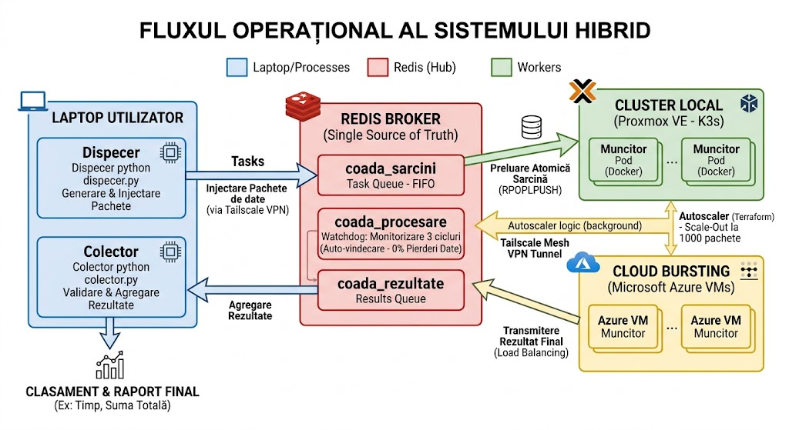
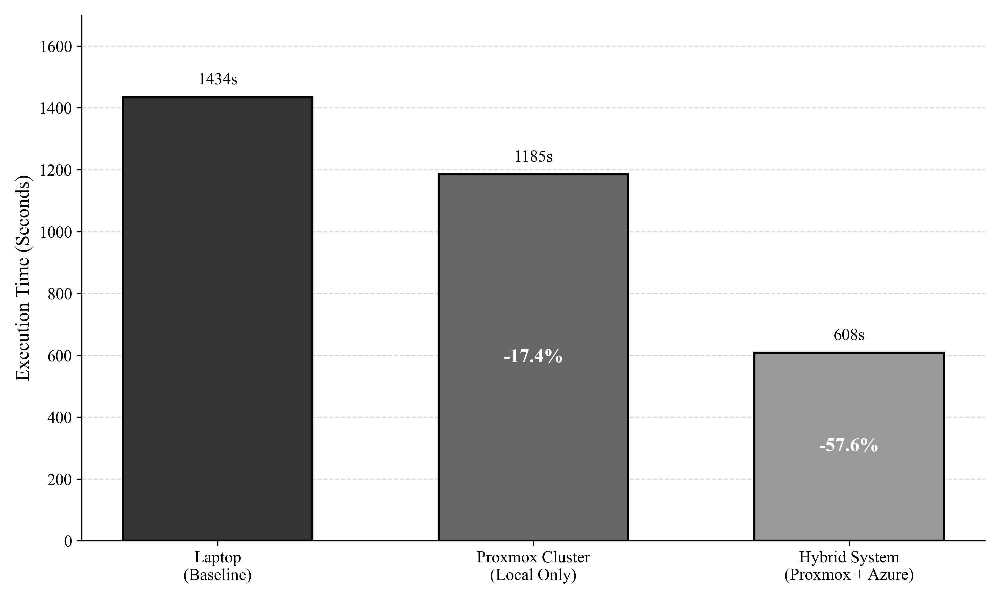

# Hybrid Cloud Autoscaler for K3s

Proiect TPI: un sistem de calcul distribuit care rulează pe un cluster **K3s** local
(VM-uri în **Proxmox**) și, când coada de lucru crește, pornește automat mașini în
**Azure** cu **Terraform**. Toate nodurile comunică printr-o rețea privată **Tailscale**.

Sarcina de test e una de forță brută: numărarea numerelor prime din intervale mari,
împărțite în pachete.



## Arhitectura

```
 Laptop (client)                     Proxmox (local)                          Azure (la cerere)
 ┌──────────────┐      Tailscale     ┌────────────────────────────────┐       ┌─────────────────────┐
 │ dispecer.py  │ ─── pachete ─────▶ │ K3s master + worker-1          │       │ azure-worker-0..N   │
 │ colector.py  │ ◀── rezultate ──── │  ├─ redis-baza  (NodePort 30474)│ ◀──── │  2 x muncitor       │
 └──────────────┘                    │  ├─ echipa-muncitori (x3)      │       │  (Docker)           │
                                     │  ├─ recuperator-tpi (watchdog)  │       └─────────────────────┘
                                     │  └─ autoscaler.py (systemd) ───┼── terraform apply ──▶
                                     └────────────────────────────────┘
```

Cozile din Redis:

| Coadă | Rol |
|---|---|
| `coada_sarcini` | pachete noi, puse de dispecer |
| `coada_procesare` | pachete luate de un muncitor, dar încă nerezolvate |
| `coada_rezultate` | rezultate, citite de colector |

Componente:

- **`client/dispecer.py`**: împarte intervalul în pachete (implicit 2500) și le pune în `coada_sarcini`.
- **`muncitor/muncitor.py`**: ia atomic un pachet (`RPOPLPUSH` în `coada_procesare`), calculează și trimite rezultatul.
- **`client/colector.py`**: strânge rezultatele, măsoară timpul total și arată câte pachete a rezolvat fiecare muncitor.
- **`recuperator/recuperator.py`**: watchdog care mută înapoi pe bandă pachetele rămase blocate în `coada_procesare`, de exemplu când o mașină din Azure e oprită în timp ce lucra.
- **`autoscaler/autoscaler.py`**: verifică lungimea cozii la fiecare 10 secunde și rulează `terraform apply -var=numar_masini=N`:
  - peste 1000 de pachete: 3 mașini în Azure
  - peste 300: 1 mașină (sau păstrează 3 dacă erau deja pornite)
  - coadă goală 6 cicluri la rând (~1 minut): 0 mașini, deci resursele din cloud sunt șterse
- **`infra/azure/main.tf`**: creează N VM-uri `Standard_B2ats_v2` (Ubuntu 22.04). Fiecare intră în Tailscale și pornește 2 containere muncitor.

## Rezultate



| Configurație | Timp |
|---|---|
| Laptop, un singur nucleu (`benchmark/benchmark_local.py`) | 1434 s |
| Cluster Proxmox (doar local) | 1185 s (−17,4%) |
| Hibrid: Proxmox + Azure | 608 s (−57,6%) |

## Rulare

### 1. Cluster K3s

```bash
kubectl apply -f k8s/
```

Comanda pornește Redis (expus pe NodePort `30474`), 3 muncitori și watchdog-ul.

### 2. Infrastructura Azure

```bash
cd infra/azure
cp terraform.tfvars.example terraform.tfvars   # completează parola, cheia Tailscale, IP-ul Redis
az login
terraform init
```

State-ul Terraform e ținut într-un Storage Account din Azure (backend `azurerm`), deci nu e în repo.

### 3. Autoscaler (pe nodul master)

```bash
sudo cp autoscaler/cloud-autoscaler.service /etc/systemd/system/
sudo systemctl daemon-reload
sudo systemctl enable --now cloud-autoscaler
```

### 4. Test

```bash
pip install -r requirements.txt
export REDIS_HOST=100.x.y.z   # IP-ul Tailscale al nodului K3s
python client/colector.py     # într-un terminal
python client/dispecer.py     # în alt terminal
```

## Configurare

Toate scripturile Python citesc adresa Redis din variabile de mediu:

| Variabilă | Implicit | Folosită de |
|---|---|---|
| `REDIS_HOST` | `localhost` | toate |
| `REDIS_PORT` | `30474` | toate |
| `TF_DIR` | `../infra/azure` | autoscaler |

## Imagini Docker

| Componentă | Imagine | Build |
|---|---|---|
| muncitor | `ovidiuu/muncitor-tpi:v7` | `docker build -t ... muncitor/` |
| recuperator | `ovidiuu/recuperator-tpi:v3` | `docker build -t ... recuperator/` |
| autoscaler | `ovidiuu/autoscaler-tpi:v1` (opțional; de obicei rulează ca serviciu systemd) | `docker build -t ... autoscaler/` |

Autoscaler-ul în Docker are nevoie de folderul Terraform montat și de credențiale Azure:

```bash
docker run -d -e REDIS_HOST=... -v $(pwd)/infra/azure:/infra \
  -e ARM_CLIENT_ID=... -e ARM_CLIENT_SECRET=... \
  -e ARM_TENANT_ID=... -e ARM_SUBSCRIPTION_ID=... \
  ovidiuu/autoscaler-tpi:v1
```

## Tehnologii

Proxmox VE · K3s · Docker · Redis · Python · Terraform · Microsoft Azure · Tailscale
